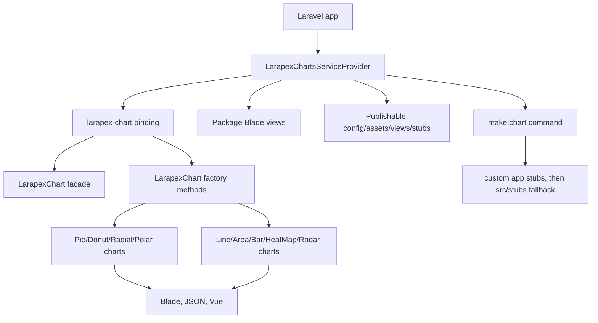

# Project Overview

Larapex Charts is a PHP library for Laravel apps. It wraps ApexCharts with a
fluent chart builder, service provider, facade, publishable config/views/assets,
and `make:chart` stubs for Blade, JSON, and Vue output.

## Repository Structure

- `.agents/skills/` repo-owned agent skills; `.claude/skills` and `CLAUDE.md`
  are symlinks to `.agents/skills/` and `AGENTS.md`, so edit the targets.
- `.github/` CI, Release Please, and Dependabot configuration.
- `config/` publishable `larapex-charts.php` config.
- `docs/adr/` architecture decision records; check them before proposing a
  structural refactor.
- `resources/boost/` Laravel Boost resources, including the distributed
  consumer skill.
- `src/` package source, chart classes, facade, contracts, traits, command, and
  `make:chart` stubs.
- `stubs/` publishable ApexCharts asset and Blade views.
- `tests/` PHPUnit/Testbench feature and unit tests.

## Build & Development Commands

Run `composer install` once. The full local gate mirrors CI order and changes no
files:

```bash
vendor/bin/rector process --dry-run && composer lint:test && composer test:types && composer test
```

Other `composer.json` scripts: `lint` (Pint, rewrites files), `refactor`
(Rector, rewrites files), and `test-coverage` (HTML report in `coverage/`).
Before dependency metadata changes, run
`composer validate --no-check-publish --strict`.

Run a local CI-matrix slice. The first command edits `composer.json`, so restore
it before committing:

```bash
composer require \
  "laravel/framework:<version>" \
  "orchestra/testbench:<version>" \
  --no-interaction \
  --no-update
composer update --prefer-lowest --prefer-dist --no-interaction
composer update --prefer-stable --prefer-dist --no-interaction
vendor/bin/phpunit
```

> TODO: No dev server, debug command, or deploy command is configured.

## Code Style & Conventions

- PHP namespace stays `ArielMejiaDev\LarapexCharts\` for source and public API.
- Composer package is `gigerit/larapex-charts`; do not rename PHP imports to
  `Gigerit\...`.
- Fluent setters mutate chart state and return `static`, so chains keep the
  chart subclass type that typed `make:chart` classes declare.
- Chart subclasses stay thin: extend `LarapexChart`, set ApexCharts type in the
  constructor, and use the right data trait.
- Simple charts implement `MustAddSimpleData` and use
  `SimpleChartDataAggregator`.
- Complex charts implement `MustAddComplexData` and use
  `ComplexChartDataAggregator`.
- Preserve public names and return shapes for `container()`, `script()`,
  `toJson()`, and `toVue()` unless the task explicitly changes API behavior.
- Commit messages follow Conventional Commits (`feat:`, `fix:`, `docs:`, `ci:`,
  `chore:`). Release Please derives versions and `CHANGELOG.md` from them, so
  `CHANGELOG.md` and `.release-please-manifest.json` change only in release PRs.

## Architecture Notes



`LarapexChartsServiceProvider` binds `larapex-chart`, merges config, loads views
from `stubs/resources/views`, publishes config/assets/views/stubs, and
registers `make:chart`.

`LarapexChart` owns shared chart state, factory methods, and outputs.
Factories return independent subclasses for specific ApexCharts types. Blade,
JSON, and Vue output all project one options array built by `apexOptions()`.
Before changing a setter, output, chart type, or stub, read
`.agents/skills/larapex-chart-api/SKILL.md`.

`src/stubs/charts` is the single source of `make:chart` stubs: `ChartMakeCommand`
falls back to it, and the `larapex-charts-stubs` tag publishes it to an app's
`stubs/charts`, whose copies take precedence.

## Testing Strategy

- Tests use PHPUnit with Orchestra Testbench and `vendor/autoload.php`.
- PHPStan is configured at level 8 in `phpstan.neon.dist`; run it with
  `composer test:types`.
- `tests/TestCase.php` registers the provider and facade alias, using in-memory
  SQLite.
- Feature tests cover chart construction, view rendering, facade behavior,
  independent chart instances, and Vue output.
- Unit tests cover publishing, running every `make:chart` stub both as
  published and as package fallback, script loading, config color overrides,
  and the ApexCharts CDN URL.
- `phpunit.xml.dist` randomizes order and fails on warnings, risky tests, and
  empty suites.
- CI checks Rector and Pint without changing source before PHPStan and PHPUnit,
  then runs an Ubuntu coverage job with PCOV and the PHPUnit matrix on Ubuntu
  and Windows for PHP
  8.3, 8.4, 8.5; Laravel 12, 13; and `prefer-lowest` plus `prefer-stable`.
  Pull requests and pushes to `master` run CI; release automation runs only on
  default-branch pushes. Matrix execution is limited to two parallel jobs.
- No end-to-end/browser suite is configured.

## Security & Compliance

- MIT license; see `LICENSE.md`. The bundled `stubs/public/apexcharts.js` is
  npm `apexcharts` `dist/apexcharts.min.js` (version in its header) under the
  non-MIT ApexCharts License. When updating it, verify the tarball against the
  registry integrity hash, keep the `cdn()` major pin in step, and update the
  version in `README.md` and the Boost skill. PHPUnit never runs ApexCharts, so
  for a new major render every chart type's `script()` output on the old and
  new asset in headless Chromium (`--headless=new --dump-dom
  --virtual-time-budget=15000 --allow-file-access-from-files`) and compare JS
  errors and drawn SVG.
- No secrets or `.env` files are required for normal package work.
- Do not commit credentials, tokens, private registry auth, or local `.env`.
- `composer.lock` is ignored; CI resolves dependencies for the selected matrix.
- If blocked by a bug/gap in a dependency owned by `gigerit` (`gigerit/*`,
  `@gigerit/*`, or author/provider/creator starts with `gigerit`), do not patch
  around it here. Stop and report package, version, blocker, expected/actual,
  repro/code path, and suggested dependency fix. Continue only after dependency
  fix or explicit user workaround approval.

## Agent Guardrails

- Shared worktree: do not revert, clean, stage, move, delete, or reformat
  unrelated user/agent changes. If overlap exists, preserve other work and make
  the smallest compatible edit.
- Keep repo clean: no temporary files, dead code, dead files, or needless dirs.
- Do not run destructive git commands unless explicitly requested.
- Keep changes compatible with Composer constraints: PHP `^8.3`,
  `illuminate/support` `^12.0|^13.0`, Testbench `^10.0|^11.1`,
  PHPUnit `^11.5.50|^12.5.8|^13.0.3`, PHPStan `^2.1`.
- Chart API or output-builder changes need tests for affected Blade, JSON, and
  Vue surfaces.
- `make:chart` or generated-example changes need tests for published stubs and
  package fallback stubs.
- Do not add tooling, generated files, or broad refactors unless requested.
- Documentation placement: user-facing behavior changes update both
  `README.md` and the distributed consumer skill
  `resources/boost/skills/larapex-charts-development/SKILL.md`; use root
  `AGENTS.md` only for durable repo-wide guidance; use skills under
  `.agents/skills` for bounded subsystem knowledge; use code comments only for
  non-obvious local behavior.
- Before finalizing, verify `AGENTS.md`, `README.md`, the consumer skill,
  repo-owned skills under `.agents/skills`, and code comments need no further
  update. Avoid duplicate docs; place new docs at the narrowest correct level.

## Extensibility Hooks

- Laravel auto-discovers provider and facade alias through `composer.json`.
- Laravel Boost can discover
  `resources/boost/skills/larapex-charts-development/SKILL.md` in consuming apps
  that install this package and `laravel/boost`.
- Consumers can publish config, views, local ApexCharts asset, and
  stubs through service-provider publish tags.
- Config controls default font family, font color, and palette.
- `make:chart` supports `--vue` or `--json`, never both; custom app stubs from
  `base_path("stubs/charts/...")` win before package fallback stubs.
- Default CDN helper returns `https://cdn.jsdelivr.net/npm/apexcharts@8`,
  pinned to the bundled asset's ApexCharts major.

> TODO: No feature flags or package-specific environment variables were found.

## Further Reading

- `README.md` install, usage examples, and roadmap.
- `composer.json` metadata, autoloading, scripts, and Laravel auto-discovery.
- `phpstan.neon.dist` PHPStan level and analysis paths.
- `phpunit.xml.dist` PHPUnit configuration.
- `.github/workflows/ci.yml` CI matrix and Release Please workflow.
- `release-please-config.json` and `.release-please-manifest.json` release setup.
- `config/larapex-charts.php` configurable defaults.
- `src/LarapexChart.php` fluent chart API, options builder, and outputs.
- `src/LarapexChartsServiceProvider.php` bindings, publish tags, and views.
- `src/Console/ChartMakeCommand.php` generated chart behavior.

## Maintaining this file

Keep this file for knowledge useful to almost every future agent session in this project.
Do not repeat what the codebase already shows; point to the authoritative file or command instead.
Prefer rewriting or pruning existing entries over appending new ones.
When updating this file, preserve this bar for all agents and keep entries concise.
